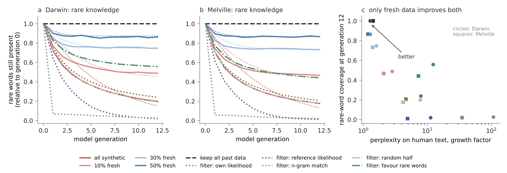

# Who Pays for the Knowledge Models Copy? Model Collapse as Rogers' Paradox

**Nam H. Le** — Department of Computer Science and Vermont Complex Systems Institute, University of Vermont · [drnamlabs.com](https://drnamlabs.com)

[](https://doi.org/10.5281/zenodo.23298661)

Code, per-seed results, and figures for the paper
([PDF](paper/Le2026_model_collapse_rogers_paradox.pdf) · [Zenodo, doi:10.5281/zenodo.23298661](https://doi.org/10.5281/zenodo.23298661)).

Generative models trained on the output of earlier models lose knowledge across
generations, rare knowledge first. This work reads model collapse as Rogers' paradox
from cultural evolution: copying is cheaper than learning, so copying spreads, but
copies go stale unless someone keeps learning for themselves. It shows that

- a one-parameter Rogers chain, fitted to fully synthetic training only, predicts how
  much rare knowledge a lineage of language models retains under other mixtures of
  fresh data, and a small transformer shows the same pattern;
- when the world changes, the fresh fraction a lineage needs rises with the rate of change;
- when the people who write a model's training data can ask the model instead, the
  model ends up exactly as reliable as finding out is costly, and model-written text
  must be paid for by people who keep learning for themselves;
- synthetic-data filters are social learning strategies: those that select plausible
  text act as conformist copying and accelerate collapse.



## Repository layout

| path | contents |
|---|---|
| `experiments/collapse_filters.py` | word-trigram lineages, fresh-data mixtures and filters (Sec. 4, 7) |
| `experiments/collapse_drift2.py` | recursive training in a world that keeps changing (Sec. 5) |
| `experiments/neural_collapse.py` | character-level transformer replication (Sec. 4) |
| `experiments/opt_collapse.py` | pretrained OPT-125m fine-tuned on its own output, wikitext-2, Shumailov et al. setting (Sec. 4) |
| `experiments/opt_drift.py`, `opt_drift_analysis.py` | OPT-125m in a world that keeps changing (Sec. 5) |
| `experiments/chain_fit.py` | one- vs two-class Rogers' chain fitted to all-synthetic training, all models (Appendix B) |
| `experiments/results_*.json`, `experiments/neural/`, `experiments/opt/`, `experiments/opt_drift/` | per-seed results used in the paper |
| `experiments/data/` | Darwin's *Origin of Species* and Melville's *Moby-Dick* (Project Gutenberg, public domain) |
| `paper/figures/fig*.py` | scripts that draw every figure from the results above; `figeco.py` also runs the human–AI ecosystem simulation (Sec. 6) |

## Reproducing

Python 3.10+ with `numpy`, `scipy`, `matplotlib`, and (for the transformers only) `torch`; the OPT-125m run also needs `transformers` and `datasets` and a GPU (about 3–4 min per lineage on one RTX 5090).

```bash
cd experiments
python collapse_filters.py origin        # and: moby
python collapse_drift2.py
python neural_collapse.py replace 0      # one condition and seed per call; see neural_jobs.txt
python opt_collapse.py replace 0       # or: python opt_collapse.py all  (runs opt_jobs.txt)
python opt_drift.py all                # runs opt_drift_jobs.txt; then: python opt_drift_analysis.py
python chain_fit.py
cd ../paper/figures
python figexp.py && python figdrift.py && python figeco.py && python figneural.py && python figopt.py
```

The JSON files already in the repository reproduce every number and figure in the
paper without rerunning the experiments.

## Using or building on this work

Fork the repository with the **Fork** button, or copy any part of it. The code is
MIT-licensed: you may reuse and modify it freely, provided the copyright notice
(`Copyright (c) 2026 Nam H. Le`) and the license are kept in every copy. If the code
or the results help your work, please cite the paper; GitHub's **Cite this repository**
button (from `CITATION.cff`) gives the citation in BibTeX and APA.

```bibtex
@misc{le2026rogers,
  author = {Le, Nam H.},
  title  = {Who Pays for the Knowledge Models Copy? Model Collapse as Rogers' Paradox},
  year   = {2026},
  publisher = {Zenodo},
  doi    = {10.5281/zenodo.23298661},
  url    = {https://doi.org/10.5281/zenodo.23298661},
  note   = {Preprint}
}
```

## License

Code: MIT (see `LICENSE`). Paper PDF: CC BY 4.0. Texts in `experiments/data/`: public domain.
